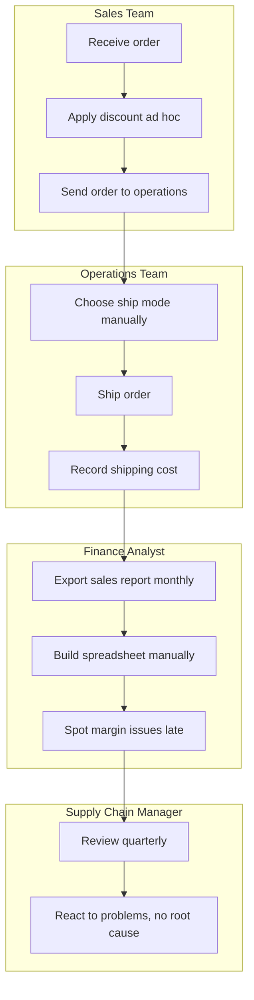
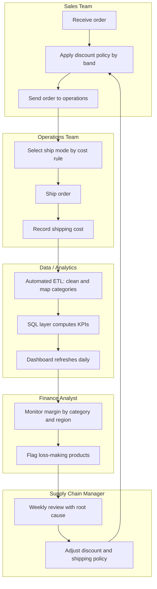

# Process Maps — Food Supply Chain Sales & Profitability

## AS-IS Process (current state)

**Pain points:** ad-hoc discounting, manual ship-mode choice, monthly lag, no category/region view, reactive decisions.

---

## TO-BE Process (future state)

**Improvements:** discount policy by band, ship-mode cost rule, automated ETL, daily dashboard, weekly root-cause review, feedback loop into pricing.

---

## Gap Analysis

| # | Gap (AS-IS) | Impact | TO-BE Change | Owner |
|---|---|---|---|---|
| 1 | Ad-hoc discounting | Margin erosion | Discount policy by band | Sales Director |
| 2 | Manual ship-mode choice | Higher shipping cost | Cost-based ship-mode rule | Operations Team |
| 3 | Monthly manual reporting | Slow reaction | Automated ETL + daily dashboard | Data / Analytics |
| 4 | No category/region view | Blind spots | Category and province KPIs | Finance Analyst |
| 5 | No loss-making product flag | Hidden losses | Automated flag in dashboard | Finance Analyst |
| 6 | Reactive quarterly review | Missed opportunities | Weekly root-cause review | Supply Chain Manager |
